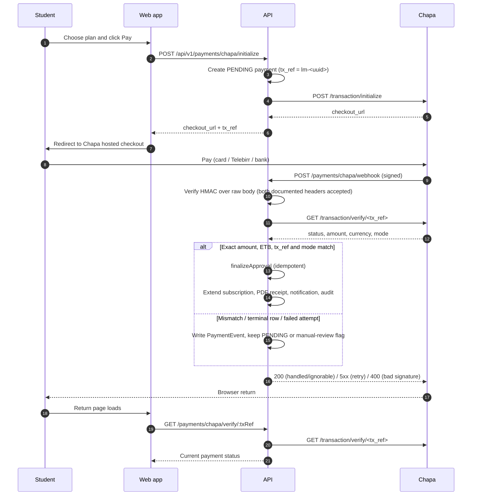

# Payments: lifecycle and deployment

The application has **two independent payment rails**. They share the same
`Payment` / `PaymentEvent` ledger and the same idempotent approval path, but
they are configured and verified differently.

| Rail | How money is confirmed | Required account/credentials | Launch status |
|---|---|---|---|
| **Chapa** (card / Telebirr / bank checkout) | Chapa's hosted checkout + signed webhook + **server-side verify call** | Chapa merchant account (KYC), live secret key, webhook secret | Optional — bank transfer works without it |
| **Bank receipt** (direct transfer) | Receipt extraction from the bank's live receipt source (Cheki primary, receipt-verifier fallback) + admin review | Receiving account(s), verifier shared token, optional `COMPANY_BANK_ACCOUNTS` fallback | Primary path at launch |

Both rails obey the same safety rules:

- every status change goes through `PaymentStateMachine` (guarded update +
  immutable `PaymentEvent` in one transaction);
- approval is idempotent — duplicate webhooks, retries or double-clicks cannot
  double-activate a subscription;
- an approved payment extends the subscription, writes the receipt number,
  generates the PDF and notifies the student;
- mismatches, ambiguity and failures stay visible in the admin payment queue.

---

## 1. Chapa rail

> Chapa is **optional**. Env validation treats `CHAPA_SECRET_KEY` and
> `CHAPA_WEBHOOK_SECRET` as all-or-nothing: set both or leave both blank.
> Production refuses to boot with a test key (`CHASECK_TEST-…`).

### 1.1 Create the merchant account

1. Go to <https://dashboard.chapa.co> and sign up as a business/merchant.
2. Complete **business verification** (KYC). For an educational institution
   Chapa typically asks for:
   - business/trade licence or institution registration;
   - TIN;
   - the authorised person's ID;
   - the **bank account for settlement** (this is the Chapa settlement
     account, configured only in the Chapa dashboard — it is **not** an app
     env var).
3. Verification is manual on Chapa's side and can take a few business days.
   **Test keys are issued immediately**; **live keys unlock after approval**.

**Two different "bank accounts" — do not confuse them:**

| | What it is | Where it is configured |
|---|---|---|
| **Chapa settlement account** | Where Chapa deposits money collected through Chapa checkout | Chapa dashboard only (during business verification) |
| **Receiving accounts for direct transfers** | Accounts students transfer into directly, used by the bank-receipt rail | `/admin/banks` in the app (primary); legacy `COMPANY_BANK_ACCOUNTS` fallback |

They are often the same physical account, but they are configured in two
different systems.

### 1.2 Test keys first (sandbox)

In **Settings → API Keys** copy the test key (`CHASECK_TEST-…`) and use it to
prove the flow end-to-end before going live:

```env
# .env (local) or a staging .env.production
CHAPA_BASE_URL=https://api.chapa.co/v1
CHAPA_SECRET_KEY=CHASECK_TEST-xxxxxxxx
CHAPA_WEBHOOK_SECRET=<webhook secret from the dashboard, see §1.4>
CHAPA_RETRY_WINDOW_MINUTES=60
```

### 1.3 Live keys (production)

After approval, switch to the **Live** toggle in the dashboard and copy the
live secret key (`CHASECK-…`, no `TEST`). In `.env.production`:

```env
CHAPA_BASE_URL=https://api.chapa.co/v1
CHAPA_SECRET_KEY=CHASECK-xxxxxxxx        # LIVE secret — server env only
CHAPA_WEBHOOK_SECRET=<live webhook secret>
CHAPA_RETRY_WINDOW_MINUTES=60            # match the dashboard checkout timeout
```

> **Test vs live separation.** Never mix a test key with live traffic or
> vice-versa. Production raises a boot-time error if `CHAPA_SECRET_KEY`
> contains `TEST`. Every verified transaction also reports `mode` (`test` or
> `live`); when present it must match the environment — `live` in production,
> `test` elsewhere — otherwise the payment is routed to manual review instead
> of being approved.

### 1.4 Configure the webhook

The code already sends the callback and return URLs on every checkout, but the
webhook must also be registered and given a secret in the dashboard:

| Purpose | URL your app uses | Notes |
|---|---|---|
| **Webhook** (server→server, source of truth) | `https://api.your-domain/api/v1/payments/chapa/webhook` | Chapa POSTs here signed with the webhook secret. |
| **Callback** (Chapa redirects the browser to the API) | `https://api.your-domain/api/v1/payments/chapa/callback` | Sent automatically by the API on every checkout (`callback_url`). |
| **Return** (browser lands on the web app) | `https://your-domain/pricing/payment/callback?tx=<txRef>` | Sent automatically by the API on every checkout (`return_url`). |

Dashboard settings:

1. **Settings → Webhooks** → set the webhook URL to
   `/api/v1/payments/chapa/webhook`.
2. Set/copy the **webhook secret hash** → put it in `CHAPA_WEBHOOK_SECRET`.
   The same value must exist on both sides; rotating it requires updating both.
3. The webhook must be **internet-reachable over HTTPS** — DNS and TLS
   (Nginx/certbot) must already be live for the API subdomain.
4. Set the **checkout/retry timeout** to the value you put in
   `CHAPA_RETRY_WINDOW_MINUTES` (default and documented value: **60
   minutes**). A payment younger than this is never treated as abandoned.
5. Decide whether the **customer pays the fee**. This is a commercial setting
   only: the app compares the settled `amount`, never Chapa's `charge` field.

**Webhook status codes are deliberate.** Chapa retries every **10 minutes, up
to 10 attempts over 72 hours**, and stops at any 2xx:

| Response | When |
|---|---|
| **200** | The event was durably handled (approved) or is deterministically ignorable (unknown reference, not paid yet, mismatch/terminal state, lifecycle event recorded). |
| **400** | Bad signature or malformed JSON body — never retryable. |
| **5xx** | Transient failure: verify timeout/unreachable or a database error. Chapa retries without us losing the event. |

### 1.5 Sequence diagram



### 1.6 Lifecycle in detail

1. `POST /api/v1/payments/chapa/initialize` creates a `PENDING` payment with
   `tx_ref = lm-<uuid>` (a fresh random UUID per checkout — Chapa permanently
   reserves a `tx_ref`, so it is never reused) and returns Chapa's hosted
   `checkout_url`. At most one `PENDING` payment per user is allowed; a second
   concurrent checkout is refused.
2. The student pays on Chapa's hosted page.
3. Chapa POSTs the webhook. The API verifies the HMAC-SHA256 signature over the
   **raw request body**, then calls Chapa's verify endpoint before changing
   anything. The signature proves the sender holds the secret; **the
   server-side verify call is the real control**. No payment is approved from a
   webhook body alone.
4. The verify response is compared with the payment snapshot:
   - `tx_ref` must be present and exactly equal to our reference;
   - `currency` must be present and `ETB`;
   - `amount` must be present and exactly equal to the snapshot — decimal
     comparison with no float tolerance (a one-cent difference is a mismatch);
   - `mode`, when present, must be `live` in production and `test` elsewhere.
5. Only an exact match is approved. Approval extends the subscription, writes
   the receipt number, generates the PDF and notifies the student. Duplicate
   webhooks and the browser return hit the same guarded transition and cannot
   double-activate.
6. The browser lands on the return URL; that page calls
   `GET /payments/chapa/verify/:txRef`, which re-checks with Chapa. The UI never
   trusts the redirect alone.

**Mismatches and failed attempts.** A mismatch keeps the payment `PENDING`,
writes `CHAPA_VERIFY_MISMATCH`, and flags an admin-queue exception — never an
auto-approval and never a customer-facing amount message. A verify call that
reports `failed`/`cancelled` **once is not terminal**: Chapa's documentation
does not define what verify returns between attempts, and the customer may
retry inside the retry window, so the API records `CHAPA_ATTEMPT_FAILED` with
the reported status and keeps the payment `PENDING`. It is not rejected.

**Retry window and cancellation.** A `PENDING` checkout younger than
`CHAPA_RETRY_WINDOW_MINUTES` (default 60, matching the dashboard) is still
open: a retry resumes the stored checkout URL instead of creating a duplicate.
Past the window the API first calls `PUT /v1/transaction/cancel/<tx_ref>`
(bearer secret, timeout). Only a confirmed dead link is expired locally
(`PENDING → EXPIRED`, `PAYMENT_EXPIRED`). If Chapa reports the checkout was
already paid, the normal verify-and-approve path runs instead. If Chapa is
unreachable or refuses, **nothing changes** and the student gets a clear retry
message. A student cancelling their own checkout goes through the same
cancel-at-Chapa check before the local `PENDING → CANCELLED` transition.

**Cancel racing a paid webhook.** A cancel that lands in the same instant Chapa
confirms the money moved must never win silently. The approval path re-reads the
row and revives a `CANCELLED`/`EXPIRED` checkout (see "Late payments" below), and
if it still cannot claim the row the webhook answers `5xx` so Chapa redelivers.
The student's cancel therefore either completes before the money arrives or is
reported back as already-paid — the payment is never dropped.

**Late payments after a closed checkout.** `EXPIRED → APPROVED` and
`CANCELLED → APPROVED` are allowed **only** through verified gateway paths
(webhook, callback, verify endpoint, lazy resolution). The approval records
`PAYMENT_APPROVED_AFTER_EXPIRY` with the previous status, runs the normal
subscription/receipt/notification flow, and shows a "Recovered from
expired/cancelled" badge in the admin queue. Admin manual approval can never
reopen a closed row. `REJECTED` and `REVERSED` stay terminal; a late exact
payment on either records `CHAPA_LATE_PAYMENT_TERMINAL`, **stamps `chapaRef`**
and sets `verification.exception = true` so the money is admin-visible and
refundable.

**The admin queue never hides verified money.** A Chapa row created before the
student paid has no `chapaRef`; those unconfirmed attempts (`PENDING`, or a
failed initialization rejected as `REJECTED`) are deliberately kept out of the
review queue because Chapa payments can only be approved through verification.
A row is listed as soon as **any** of these holds: it is not a Chapa payment,
Chapa has confirmed it (`chapaRef` stamped), it carries a review exception, or
its status is not an unconfirmed attempt. The *Exceptions* tab
(`GET /payments/admin?exceptions=true`) lists every payment with
`verification.exception = true` regardless of status or method — a reported
refund, a late payment on a terminal row, an under/overpayment — with its own
count, so a row needing a human can never be missed.

**Refunds, reversals and failed events.** Webhook events `charge.refunded`
(status `refunding` or `refunded`), `charge.reversed`, and `charge.failed`
(or a `cancelled` status) always write a `PaymentEvent`
(`CHAPA_REFUND_RECEIVED`, `CHAPA_REVERSAL_RECEIVED`,
`CHAPA_FAILED_OR_CANCELLED`). A refund or reversal on an `APPROVED` payment is
flagged in the admin queue for human review; the subscription is **never**
auto-cancelled and the payment status is not changed automatically. A
failed/cancelled webhook changes no state beyond the ledger entry. Refunds and
chargebacks are still executed in the Chapa dashboard.

### 1.7 Security checklist

- Keys live in `.env.production` (server env), never in the repo or a client
  bundle.
- `CHAPA_WEBHOOK_SECRET` is set, so signature verification is active.
- The webhook is HTTPS-only.
- Never hardcode keys, secrets or account numbers in source.
- Amounts and subscription duration come from the server-side plan snapshot,
  not the client.
- Production refuses test keys at boot and rejects a `mode` mismatch.

### 1.8 End-to-end test before launch

1. With **test** keys, run a full checkout using Chapa's test cards/numbers.
2. Confirm `PENDING → webhook received → subscription ACTIVE → PDF receipt`.
3. POST to the webhook without a valid signature and confirm it is rejected
   (`400`).
4. Start another checkout, cancel it from the student UI, and confirm Chapa's
   checkout link is dead before the row becomes `CANCELLED`. Then confirm a
   retry can start a fresh checkout.
5. Switch to **live** keys, take ONE small real payment, confirm settlement
   appears in the Chapa dashboard balance, then refund or reconcile. A refund
   webhook should flag the approved payment in the admin queue without
   cancelling access.

### 1.9 Required environment variables (summary)

| Variable | Where | Secret? |
|---|---|---|
| `CHAPA_BASE_URL` | `.env.production` (`https://api.chapa.co/v1`) | no |
| `CHAPA_SECRET_KEY` | `.env.production` | **yes** |
| `CHAPA_WEBHOOK_SECRET` | `.env.production` | **yes** |
| `CHAPA_RETRY_WINDOW_MINUTES` | `.env.production` (default 60) | no |
| `API_PUBLIC_URL` / `WEB_PUBLIC_URL` | `.env.production` (build webhook/return URLs) | no |
| Settlement bank account | **Chapa dashboard** (not the app) | — |

---

## 2. Bank-receipt rail

The receipt verifier validates direct Ethiopian bank or Telebirr transfers. It
is separate from Chapa: Chapa payments are verified with Chapa's API and
webhook, while this service extracts data from a bank receipt reference or URL.
Cheki is the primary automated source when enabled; the Python verifier is the
fallback/self-hosted extractor. Both feed the same `PaymentsService` decision
path — no extraction service can approve a payment by itself.

### 2.1 Sequence diagram

```mermaid
sequenceDiagram
    autonumber
    participant S as Student
    participant W as Web app
    participant API as API
    participant V as Cheki / receipt verifier
    participant B as Bank receipt source

    S->>W: Upload receipt image or enter reference/URL
    W->>API: POST /payments/submit (multipart) or POST /payments/verify
    API->>V: Extract receipt (Cheki lookup or POST /extract with x-verifier-token)
    V->>B: Fetch the live receipt page
    B-->>V: Receipt data
    V-->>API: Normalized receipt (reference, amount, payer, receiver, status)
    API->>API: assessReceipt: receiver match, amount, status, duplicate reference
    alt Receiver matches and amount >= plan price and status success/unknown
        API->>API: Approve; activate subscription; PDF receipt; notification; audit
    else Wrong receiver, underpayment, failed/cancelled status
        API->>API: Reject (hard; cannot be overridden from the dashboard)
    else Overpayment, ambiguous data, BOA (no receiver exposed), provider down
        API->>API: Keep PENDING for admin review (reason recorded)
    end
    API-->>W: Result / review message
```

### 2.2 Required values

Generate one shared token:

```bash
openssl rand -hex 32
```

Use the same token on both sides:

```env
# NestJS API
RECEIPT_VERIFIER_URL=http://127.0.0.1:8000
RECEIPT_VERIFIER_TOKEN=<generated-token>
RECEIPT_VERIFIER_TIMEOUT_MS=60000
COMPANY_BANK_ACCOUNTS=<real-college-account-1>,<real-college-account-2>

# Python verifier process
VERIFIER_SHARED_TOKEN=<generated-token>
```

`COMPANY_BANK_ACCOUNTS` is the legacy matching list for direct transfers.
Day-to-day receiving accounts are managed in **Admin → Banks** and stored in
the database (primary). If the env list is supplied, separate multiple accounts
with commas; spaces and hyphens are accepted, but each entry must contain at
least eight digits. The verifier refuses to start without a non-blank shared
token, and the API refuses to start if the URL is enabled without a token or
with account entries that do not look valid.

### 2.3 Local Windows setup

From the repository root:

```powershell
cd services/receipt-verifier
python -m venv .venv
.\.venv\Scripts\python.exe -m pip install -r requirements.txt

$env:VERIFIER_SHARED_TOKEN="<generated-token>"
.\.venv\Scripts\python.exe -m uvicorn main:app --host 127.0.0.1 --port 8000
```

Confirm the service:

```powershell
Invoke-RestMethod http://127.0.0.1:8000/health
```

Add the API values shown above to `apps/api/.env`, then restart the API.

### 2.4 VPS Docker setup

In `.env.production`:

```env
RECEIPT_VERIFIER_URL=http://verifier:8000
RECEIPT_VERIFIER_TOKEN=<generated-token>
RECEIPT_VERIFIER_TIMEOUT_MS=60000
COMPANY_BANK_ACCOUNTS=<real-college-account-1>,<real-college-account-2>
```

Do not expose port 8000 publicly. Docker Compose places the verifier and API on
the private `internal` network and maps the shared token automatically:

```bash
docker compose -f docker-compose.prod.yml --env-file .env.production up -d --build
docker compose -f docker-compose.prod.yml ps
docker compose -f docker-compose.prod.yml logs --tail=100 verifier api
```

### 2.5 Test inputs

- CBE: FT reference plus the last eight or full digits of the destination
  account.
- Telebirr: receipt ID.
- Dashen, Awash, BOA and Zemen: generally the full receipt URL.
- BOA does not expose the receiver account and therefore always enters manual
  review.
- A fake reference cannot pass because extraction uses the bank's live receipt
  source.

Use a student account that has no active subscription and no payment already
waiting for review. A successful auto-approval requires:

1. The extracted receiver matches the configured receiving account.
2. The extracted amount is at least the selected plan price.
3. The receipt status is successful, or the bank does not publish status.
4. The bank reference has not already been submitted.

If a bank blocks scraping or changes its receipt page, the application keeps
the payment pending with the submitted reference or URL for manual review.
Confirmed wrong receiving accounts, underpayments, and failed/cancelled bank
statuses are rejected and cannot be overridden from the admin dashboard.

---

## 3. Where to look next

- Account setup and costs: `INTEGRATIONS.md` §4.
- Status/event ledger semantics: `apps/api/src/modules/payments/payment-state-machine.ts`
  and `payment-event.types.ts`.
- Operator handover and known deployment prerequisites: `HANDOVER.md`
  (rows 24–27).
- Historical deployment checklist: `docs/deploy/GO-LIVE.md` and
  `docs/audit/HOSTINGER-DEPLOYMENT-PLAYBOOK.md` §4 (production test matrix).
