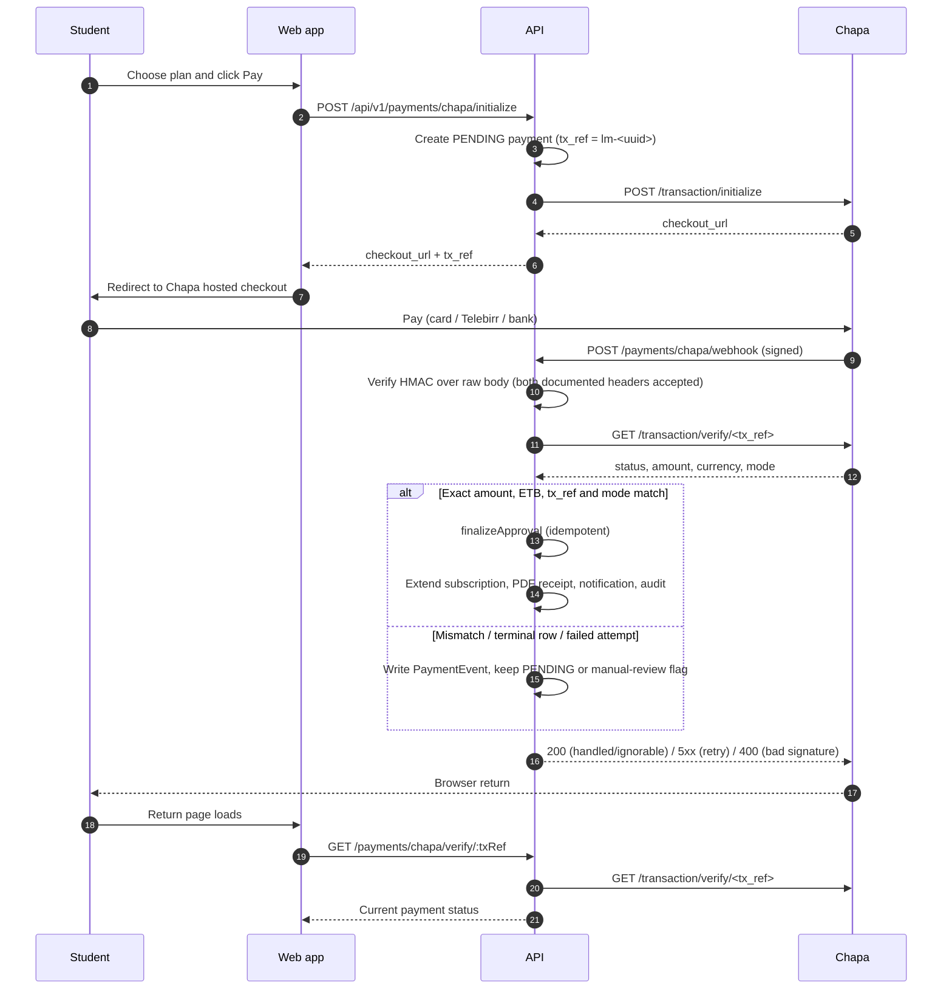

# Payments: lifecycle and deployment

The application has **two independent payment rails**. They share the same
`Payment` / `PaymentEvent` ledger and the same idempotent approval path, but
they are configured and verified differently.

| Rail | How money is confirmed | Required account/credentials | Launch status |
|---|---|---|---|
| **Chapa** (card / Telebirr / bank checkout) | Chapa's hosted checkout + signed webhook + **server-side verify call** | Chapa merchant account (KYC), live secret key, webhook secret | Optional — bank transfer works without it |
| **Bank receipt** (direct transfer) | Receipt extraction from the bank's live receipt source (Cheki primary, receipt-verifier fallback) + admin review | Receiving account(s), verifier shared token, optional `COMPANY_BANK_ACCOUNTS` fallback | Primary path at launch |

Both rails obey the same safety rules:

- every status change goes through `PaymentStateMachine` (guarded update +
  immutable `PaymentEvent` in one transaction);
- approval is idempotent — duplicate webhooks, retries or double-clicks cannot
  double-activate a subscription;
- an approved payment extends the subscription, writes the receipt number,
  generates the PDF and notifies the student;
- mismatches, ambiguity and failures stay visible in the admin payment queue.

---

## 1. Chapa rail

> Chapa is **optional**. Env validation treats `CHAPA_SECRET_KEY` and
> `CHAPA_WEBHOOK_SECRET` as all-or-nothing: set both or leave both blank.
> Production refuses to boot with a test key (`CHASECK_TEST-…`).

### 1.1 Create the merchant account

1. Go to <https://dashboard.chapa.co> and sign up as a business/merchant.
2. Complete **business verification** (KYC). For an educational institution
   Chapa typically asks for:
   - business/trade licence or institution registration;
   - TIN;
   - the authorised person's ID;
   - the **bank account for settlement** (this is the Chapa settlement
     account, configured only in the Chapa dashboard — it is **not** an app
     env var).
3. Verification is manual on Chapa's side and can take a few business days.
   **Test keys are issued immediately**; **live keys unlock after approval**.

**Two different "bank accounts" — do not confuse them:**

| | What it is | Where it is configured |
|---|---|---|
| **Chapa settlement account** | Where Chapa deposits money collected through Chapa checkout | Chapa dashboard only (during business verification) |
| **Receiving accounts for direct transfers** | Accounts students transfer into directly, used by the bank-receipt rail | `/admin/banks` in the app (primary); legacy `COMPANY_BANK_ACCOUNTS` fallback |

They are often the same physical account, but they are configured in two
different systems.

### 1.2 Test keys first (sandbox)

In **Settings → API Keys** copy the test key (`CHASECK_TEST-…`) and use it to
prove the flow end-to-end before going live:

```env
# .env (local) or a staging .env.production
CHAPA_BASE_URL=https://api.chapa.co/v1
CHAPA_SECRET_KEY=CHASECK_TEST-xxxxxxxx
CHAPA_WEBHOOK_SECRET=<webhook secret from the dashboard, see §1.4>
CHAPA_RETRY_WINDOW_MINUTES=60
```

### 1.3 Live keys (production)

After approval, switch to the **Live** toggle in the dashboard and copy the
live secret key (`CHASECK-…`, no `TEST`). In `.env.production`:

```env
CHAPA_BASE_URL=https://api.chapa.co/v1
CHAPA_SECRET_KEY=CHASECK-xxxxxxxx        # LIVE secret — server env only
CHAPA_WEBHOOK_SECRET=<live webhook secret>
CHAPA_RETRY_WINDOW_MINUTES=60            # match the dashboard checkout timeout
```

> **Test vs live separation.** Never mix a test key with live traffic or
> vice-versa. Production raises a boot-time error if `CHAPA_SECRET_KEY`
> contains `TEST`. Every verified transaction also reports `mode` (`test` or
> `live`); when present it must match the environment — `live` in production,
> `test` elsewhere — otherwise the payment is routed to manual review instead
> of being approved.

### 1.4 Configure the webhook

The code already sends the callback and return URLs on every checkout, but the
webhook must also be registered and given a secret in the dashboard:

| Purpose | URL your app uses | Notes |
|---|---|---|
| **Webhook** (server→server, source of truth) | `https://api.your-domain/api/v1/payments/chapa/webhook` | Chapa POSTs here signed with the webhook secret. |
| **Callback** (Chapa redirects the browser to the API) | `https://api.your-domain/api/v1/payments/chapa/callback` | Sent automatically by the API on every checkout (`callback_url`). |
| **Return** (browser lands on the web app) | `https://your-domain/pricing/payment/callback?tx=<txRef>` | Sent automatically by the API on every checkout (`return_url`). |

Dashboard settings:

1. **Settings → Webhooks** → set the webhook URL to
   `/api/v1/payments/chapa/webhook`.
2. Set/copy the **webhook secret hash** → put it in `CHAPA_WEBHOOK_SECRET`.
   The same value must exist on both sides; rotating it requires updating both.
3. The webhook must be **internet-reachable over HTTPS** — DNS and TLS
   (Nginx/certbot) must already be live for the API subdomain.
4. Set the **checkout/retry timeout** to the value you put in
   `CHAPA_RETRY_WINDOW_MINUTES` (default and documented value: **60
   minutes**). A payment younger than this is never treated as abandoned.
5. Decide whether the **customer pays the fee**. This is a commercial setting
   only: the app compares the settled `amount`, never Chapa's `charge` field.

**Webhook status codes are deliberate.** Chapa retries every **10 minutes, up
to 10 attempts over 72 hours**, and stops at any 2xx:

| Response | When |
|---|---|
| **200** | The event was durably handled (approved) or is deterministically ignorable (unknown reference, not paid yet, mismatch/terminal state, lifecycle event recorded). |
| **400** | Bad signature or malformed JSON body — never retryable. |
| **5xx** | Transient failure: verify timeout/unreachable or a database error. Chapa retries without us losing the event. |

### 1.5 Sequence diagram



### 1.6 Lifecycle in detail

1. `POST /api/v1/payments/chapa/initialize` creates a `PENDING` payment with
   `tx_ref = lm-<uuid>` (a fresh random UUID per checkout — Chapa permanently
   reserves a `tx_ref`, so it is never reused) and returns Chapa's hosted
   `checkout_url`. At most one `PENDING` payment per user is allowed; a second
   concurrent checkout is refused.
2. The student pays on Chapa's hosted page.
3. Chapa POSTs the webhook. The API verifies the HMAC-SHA256 signature over the
   **raw request body**, then calls Chapa's verify endpoint before changing
   anything. The signature proves the sender holds the secret; **the
   server-side verify call is the real control**. No payment is approved from a
   webhook body alone.
4. The verify response is compared with the payment snapshot:
   - `tx_ref` must be present and exactly equal to our reference;
   - `currency` must be present and `ETB`;
   - `amount` must be present and exactly equal to the snapshot — decimal
     comparison with no float tolerance (a one-cent difference is a mismatch);
   - `mode`, when present, must be `live` in production and `test` elsewhere.
5. Only an exact match is approved. Approval extends the subscription, writes
   the receipt number, generates the PDF and notifies the student. Duplicate
   webhooks and the browser return hit the same guarded transition and cannot
   double-activate.
6. The browser lands on the return URL; that page calls
   `GET /payments/chapa/verify/:txRef`, which re-checks with Chapa. The UI never
   trusts the redirect alone.

**Dates: UTC instants, Addis Ababa display.** Every money and entitlement moment
(`Payment.paidAt`, `Subscription.startDate/endDate`, the approval and reversal
timestamps) is stored and computed as a **UTC instant**, with the month maths
done in UTC and end-of-month clamping (`Jan 31 + 1 month = Feb 28/29`). Nothing
about that changes: the columns stay `timestamp` and no backfill exists. What is
fixed is the *display*: the API renders receipt and UI dates with an explicit
`Africa/Addis_Ababa` timezone (UTC+3, no DST) instead of inheriting the host's,
so the same payment prints the same day on a UTC API container and on a
developer machine. The receipt-number year (`LM-<year>-<paymentId>`) uses the
same zone, so a payment at `2026-12-31T21:30Z` is numbered `LM-2027-…` and
prints as 1 January 2027 rather than disagreeing with itself. Concretely, a
subscription that starts `2026-01-30T22:00Z`
and ends `2026-02-28T22:00Z` is *one month* of access and shows as
`31/01/2026 – 01/03/2026` in Addis.

**The PDF receipt is never the transaction of record.** It is written *after* the
approval commits, so a full disk, a permissions problem or a render error cannot
roll back (or fail) a paid activation. Such a failure records
`RECEIPT_GENERATION_FAILED` on the ledger and the approval still succeeds. The
receipt is then **repaired on demand**: `GET /payments/:id/document` regenerates
it from the payment's own snapshot (plan name, duration, amount, payer and the
subscription period captured at approval) whenever the file is missing, so the
student's next download simply works. A regeneration writes
`RECEIPT_REGENERATED`. Admins can also force a rebuild with
`POST /payments/:id/receipt/regenerate` (the *Regenerate* action on the payment
row). If the rewrite fails too, the student gets a clear "try again" rather than
a silent missing file.

**Two receipts, both permanent.** Chapa's hosted checkout shows its own receipt,
but Chapa redirects the browser to `return_url` immediately after payment, so
that screen is replaced by our callback page. The callback page therefore shows
**View Chapa payment receipt** (Chapa's permanent
`https://chapa.link/payment-receipt/<reference>` URL, built from
`Payment.chapaRef`) next to **Download college receipt (PDF)**, and the profile
history keeps both links for an approved payment. The Chapa link is only exposed
on the authenticated owner endpoint; the public callback does not return it.
Brand the Chapa receipt in the Chapa dashboard under *Settings → Account
Settings → Customize Receipts* (logo and colours). A payment without a stored
`chapaRef` cannot show the Chapa link; the college PDF is still available.

**A confirmed payment that cannot be approved.** When Chapa verifies an exact
payment but the row cannot be approved in the same pass (the row was rejected or
reversed, or the approval claim was lost to a concurrent writer), both
`GET /payments/chapa/callback` and `GET /payments/chapa/verify/:txRef` answer
with `moneyVerified: true`, `underReview: true` and a `message` containing the
fixed sentence *"We have received your payment. It is under review and any
refund will be handled by the college. Reference &lt;payment reference&gt;."* —
never a success screen, never a stale row status, and **never** "you were not
charged". The API writes `CHAPA_VERIFY_NOT_APPROVED` (or
`CHAPA_LATE_PAYMENT_TERMINAL` for a closed row) and sets
`verification.exception = true` under a status guard, so the payment shows up in
the admin *Exceptions* tab, and the webhook answers `200` — verified money is
durable, so Chapa must not be asked to retry it. Only a verify call that could
not reach the gateway yields `RETRY` / `5xx`, because no money was confirmed.
Because Chapa can redeliver, each of these exception events is recorded at most
once per `tx_ref` in any 10-minute window, and a deduplicated redelivery writes
neither a ledger row nor a second flag. An *unreachable or timed-out* verify
reports `confirmationPending` (the student must still wait) but records no
exception: no money was confirmed, so the admin queue is not spammed. The
profile page polls the same endpoint for the student's own unresolved Chapa
payments and shows the message; the callback page keeps polling before showing
it, because the next redelivery usually finishes the approval.

**Rate limiting is per user, per tx_ref and per IP — deliberately.**
Authenticated payment routes (`POST /payments/chapa/initialize`,
`POST /payments/submit`, `POST /payments/verify`,
`GET /payments/chapa/verify/:txRef`, `POST /payments/:id/cancel`,
`GET /payments/:id/document`) are capped at **10 requests/minute per
authenticated user**, using the user id rather than the socket address. Students
behind one campus NAT therefore never share a bucket, and an abusive account
cannot escape by rotating IPs. The public browser callback
(`GET /payments/chapa/callback`) is capped at **6 requests/minute per `tx_ref`**
(either `tx_ref` or Chapa's `trx_ref` spelling); replayed redirects for the same
checkout stop there, while a different checkout is unaffected. The **global
limiter stays at 120 requests/minute** and its tracker is the authenticated user
when the signed `access_token` cookie identifies one, otherwise the client IP.
For the public callback that IP ceiling is the only abuse cap, and it is
deliberately generous because Chapa's redirect and browser retries share it.
Each Chapa browser call re-verifies with the gateway, so without these caps
anyone could burn the gateway quota (and our database) by replaying a URL. The
UI is built for it: the callback page polls five times, the profile page every
15s for about five minutes, and an HTTP 429 is never surfaced as an error to the
student. Chapa's webhook is deliberately **not** throttled — Chapa redelivers
every ~10 minutes for up to 72 hours, and dropping a redelivery could lose a
payment.

**The polling window ends in one definitive sentence.** Once the callback page
or the profile page has finished polling a payment that still reports
`confirmationPending`, it shows exactly: *"We are still confirming your payment.
You will receive a notification when your subscription is active. If nothing
changes in 30 minutes, contact support and quote reference &lt;payment
reference&gt;."* — never a failure or error screen, because the money was
confirmed. The reference is the checkout's `tx_ref`.

**Mismatches and failed attempts.** Inexact verified money (a wrong `tx_ref`,
currency, amount or mode) is never auto-approved **on any status** — including
`REJECTED`, `REVERSED`, `EXPIRED` and `CANCELLED`. It writes
`CHAPA_VERIFY_MISMATCH`, sets `verification.exception = true` and stamps
`chapaRef` when present, so an under/overpayment or a live-vs-test mode anomaly
is visible in the admin *Exceptions* tab; the row's status is not changed and no
customer-facing amount message is shown. A verify call that reports
`failed`/`cancelled` **once is not terminal**: Chapa's documentation does not
define what verify returns between attempts, and the customer may retry inside
the retry window, so the API records `CHAPA_ATTEMPT_FAILED` with the reported
status and leaves the row as it is. It is not rejected.

**Retry window and cancellation.** A `PENDING` checkout younger than
`CHAPA_RETRY_WINDOW_MINUTES` (default 60, matching the dashboard) is still
open: a retry resumes the stored checkout URL instead of creating a duplicate.
Past the window the API first calls `PUT /v1/transaction/cancel/<tx_ref>`
(bearer secret, timeout). Only a confirmed dead link is expired locally
(`PENDING → EXPIRED`, `PAYMENT_EXPIRED`). If Chapa reports the checkout was
already paid, the normal verify-and-approve path runs instead. If Chapa is
unreachable or refuses, **nothing changes** and the student gets a clear retry
message. A student cancelling their own checkout goes through the same
cancel-at-Chapa check before the local `PENDING → CANCELLED` transition.

**Cancel racing a paid webhook.** A cancel that lands in the same instant Chapa
confirms the money moved must never win silently. The approval path re-reads the
row and revives a `CANCELLED`/`EXPIRED` checkout (see "Late payments" below).
If it still cannot claim the row, the verified money is recorded as an admin
exception instead of being dropped, and the webhook answers `200`. The student's
cancel therefore either completes before the money arrives or is reported back
as already-paid/under review — the payment is never dropped and Chapa is never
asked to retry money that already moved.

**Late payments after a closed checkout.** `EXPIRED → APPROVED` and
`CANCELLED → APPROVED` are allowed **only** through verified gateway paths
(webhook, callback, verify endpoint, lazy resolution). The approval records
`PAYMENT_APPROVED_AFTER_EXPIRY` with the previous status, runs the normal
subscription/receipt/notification flow, and shows a "Recovered from
expired/cancelled" badge in the admin queue. Admin manual approval can never
reopen a closed row. `REJECTED` and `REVERSED` stay terminal; a late exact
payment on either records `CHAPA_LATE_PAYMENT_TERMINAL`, **stamps `chapaRef`**
and sets `verification.exception = true` so the money is admin-visible and
refundable. The same rule covers **inexact** money on any terminal row: it
records `CHAPA_VERIFY_MISMATCH` and the exception flag rather than being
discarded because the row was already closed.

**The admin queue never hides verified money.** A Chapa row created before the
student paid has no `chapaRef`; those unconfirmed attempts (`PENDING`, or a
failed initialization rejected as `REJECTED`) are deliberately kept out of the
review queue because Chapa payments can only be approved through verification.
A row is listed as soon as **any** of these holds: it is not a Chapa payment,
Chapa has confirmed it (`chapaRef` stamped), it carries a review exception, or
its status is not an unconfirmed attempt. The *Exceptions* tab
(`GET /payments/admin?exceptions=true`) lists every payment with
`verification.exception = true` regardless of status or method — a reported
refund, a late payment on a terminal row, an under/overpayment — plus any row
with a `CHAPA_LIFECYCLE_UNVERIFIED` or `CHAPA_VERIFY_MISMATCH` event, with its
own count, so a row needing a human can never be missed.

**Admin reversal and concurrent approvals.** An admin reversal only cancels the
subscription when it is the student's last `APPROVED` payment. That count and
the cancel run under the same per-user advisory lock
(`pg_advisory_xact_lock(hashtext('payment-activation'), hashtext(userId))`) that
`finalizeApproval` takes, so a verified approval that lands at the same moment
is serialized with the reversal instead of committing inside its window: the
reversal either sees the second payment (access kept) or finishes before it
(the approval then starts the subscription again). A reversal can therefore
never leave a paid `APPROVED` row pointing at a cancelled subscription.

**Refunds, reversals and failed events.** Webhook events `charge.refunded`
(status `refunding` or `refunded`), `charge.reversed`, and `charge.failed`
(or a `cancelled` status) always write a `PaymentEvent`
(`CHAPA_REFUND_RECEIVED`, `CHAPA_REVERSAL_RECEIVED`,
`CHAPA_FAILED_OR_CANCELLED`). A refund or reversal on **any** payment status —
not just `APPROVED` — flags `verification.exception` and stamps the row's
gateway reference when it has none, so the row appears in the admin *Exceptions*
tab; the subscription is **never** auto-cancelled and the payment status is not
changed automatically. A failed/cancelled webhook changes no state beyond the
ledger entry. Refunds and chargebacks are still executed in the Chapa dashboard.

**Lifecycle events require the body-bound signature.** Chapa documents two
headers: `chapa-signature` (HMAC of the webhook secret, keyed with itself —
identical on every request) and `x-chapa-signature` (HMAC of the event body,
keyed with the secret). The success path accepts either, because the
server-side verify call is the real control and no payment is approved from the
signed body alone. A refund, reversal or failed event is different: it changes
what an admin is asked to review, and the static header cannot prove that
*this* body is the one Chapa sent. Such events are therefore only acted on when
`x-chapa-signature` is valid. If only `chapa-signature` is present, the API
records `CHAPA_LIFECYCLE_UNVERIFIED` (evidence only — no exception flag, no
status change), answers `200` so Chapa stops retrying, and the admin
*Exceptions* tab count includes the row so the unverified gateway traffic is
visible. **Owner check before go-live:** in the Chapa sandbox, trigger a refund
and observe which header the refund webhook actually carries. If Chapa sends
only the static header, lifecycle events will be recorded as unverified by
design until the merchant account/webhook configuration starts sending
`x-chapa-signature`; raise it with Chapa support rather than weakening the
check.

**A redelivered lifecycle event is a no-op.** Chapa redelivers a webhook every
~10 minutes for up to 72 hours until it sees a `2xx`, so a refund, reversal or
failed event can arrive many times. Before anything is written, the
service looks up the events already recorded for that payment **of that type**
(`tx_ref` + event kind) and compares Chapa's own id for the event
(`reference`, falling back to `id`/`event_id`). A match means the redelivery is
acknowledged and nothing happens: no second ledger row, no repeated admin
exception flag, no duplicated notification. When neither payload carries an
event id it is treated as a replay of the most recent event of that kind, since
Chapa repeats the body verbatim. A genuinely different refund (a different
`reference`) is still recorded, and a reversal is never mistaken for an earlier
refund. Unverified events are deduplicated the same way.

The exception annotations are deduplicated by `tx_ref`, not by Chapa's event id:
`CHAPA_LATE_PAYMENT_TERMINAL` and `CHAPA_VERIFY_MISMATCH` are recorded at most
once per payment and `tx_ref` in a rolling 10-minute window. The check and the
write run in one transaction under a per-payment advisory lock
(`pg_advisory_xact_lock`), so two simultaneous redeliveries cannot both insert
a row; when the event already exists the whole annotation is skipped — no
second ledger row and no second JSON merge.

**One decision function for verified gateway money.** Every path that learns
Chapa has taken money — the webhook, the browser callback, the verify endpoint
and lazy resolution at `POST /payments/chapa/initialize` — calls
`ChapaService.processVerifiedGatewayPayment(payment, verifyResult, source)`.
It is the only code allowed to call `PaymentsService.finalizeApproval` for
gateway money, and its outcome is total:

| Outcome | Meaning |
| --- | --- |
| `APPROVED` | Exact verified money; row approved, subscription and receipt written. |
| `ALREADY_APPROVED` | The row was already approved / the gateway reference matches. |
| `RECOVERED_LATE` | An `EXPIRED`/`CANCELLED` checkout revived by exact verified money. |
| `EXCEPTION_RECORDED` | Verified money that cannot be approved now (terminal row, lost claim, inexact amount/currency/tx_ref). The row is stamped with `chapaRef`, flagged `verification.exception = true` under a status guard, given a ledger event and shown in the admin queue + *Exceptions* tab. |
| `RETRY` | **Only** when the verify call itself could not reach Chapa (no money evidence). The webhook answers `5xx`; browser endpoints report the pending-confirmation message. |
| `NOT_PAID` | Chapa did not verify money; the row is left unchanged apart from the attempt event. |

The invariant is: *if Chapa verified money, the money is never silently lost and
never reported as a transient retry.* It is enforced by an exhaustive
table-driven test on a real disposable PostgreSQL database
(`apps/api/src/modules/payments/payments.gateway.matrix.spec.ts`): 6 row
statuses × 5 verify outcomes (exact, underpaid, currency mismatch, not paid,
unreachable) × 4 entry points (webhook, callback, verify, lazy) × 5
interferences (none, redelivery, concurrent reject/cancel/approve) = **600
combinations**, asserted in one pass and reported as
`gateway-money matrix: ran 600/600 combinations`. It runs only when
`PAYMENTS_RACE_DATABASE_URL` points at a disposable database with migrations
applied (or `CI=true` + `DATABASE_URL`), so it can never touch production data.

### 1.6.1 Operational requirements for the rate limits

**`TRUST_PROXY` must match the real proxy topology.** The limits above key on
`req.ip`, which Express only resolves to the real client when it trusts the
proxies in front of the API. `TRUST_PROXY` accepts either form:

- **Recommended — trusted addresses/subnets:** a comma-separated list such as
  `loopback,172.18.0.0/16` (nginx on loopback plus the Docker bridge subnet) or
  `loopback,uniquelocal`. Express only believes `X-Forwarded-For` when the
  directly connected peer is in the list, so a client outside the proxy network
  cannot spoof its address into a fresh rate-limit bucket. Named ranges
  (`loopback`, `linklocal`, `uniquelocal`), IPs and CIDRs are accepted.
- **Hop count:** `1` for nginx only (the default in production), `2` behind
  Cloudflare, `0` only for direct local access. Kept for simple topologies.

Prefer the subnet form when you know the proxy addresses: a hop count trusts
the right-most N entries regardless of who supplied them, while a subnet list
also constrains *which peers* may supply the header. If the value is wrong -
most commonly `0` or unset outside production - every request appears to come
from the proxy's loopback address, all per-IP buckets collapse into one, and
the 120/min ceiling is shared by the whole internet-facing service.
`env.validation.ts` rejects an entry that is neither a non-negative integer nor
a valid IP/CIDR/named range, and `docs/deploy/GO-LIVE.md` records the expected
value per topology.

**Verification step (do this on staging and again after go-live):**

1. Send one request through the public edge. The simplest audited request is a
   failed login with a throwaway account, because it writes an `AuditLog` row
   without needing an admin session:
   ```bash
   curl -s -o /dev/null -X POST https://api.your-domain/api/v1/auth/login \
     -H 'Content-Type: application/json' \
     -d '{"email":"trust-proxy-probe@example.com","password":"wrong"}'
   ```
2. Read the client IP the API recorded:
   ```sql
   SELECT action, "ipAddress", meta->>'forwardedFor' AS forwarded_for, "createdAt"
   FROM "AuditLog"
   WHERE action = 'AUTH_LOGIN_FAILED'
   ORDER BY "createdAt" DESC
   LIMIT 1;
   ```
3. The row's `ipAddress` must be the public client IP you sent from (matching the
   left-most address your proxy saw in `X-Forwarded-For`), **not** `127.0.0.1` or
   a Docker-internal `172.x`/`10.x` address. If it is a proxy address,
   `TRUST_PROXY` is too low; if it is a spoofed address, it is too high. The same
   `ipAddress` is written for administrative audit entries, so an admin action
   (for example toggling an accepted bank) verifies it there too.

**The throttles are in-memory: one API instance only.** `@nestjs/throttler`
keeps its counters in process memory by default. The production compose file
runs a single `api` service, so the limits are correct as deployed. If the API is
ever scaled to more than one instance or replica, each instance counts
separately and the effective limit multiplies; configure a shared
`ThrottlerStorage` (Redis) before adding a second instance. Scaling the API
without that change must be treated as disabling the per-user and per-IP caps.

### 1.7 Security checklist

- Keys live in `.env.production` (server env), never in the repo or a client
  bundle.
- `CHAPA_WEBHOOK_SECRET` is set, so signature verification is active.
- The webhook is HTTPS-only.
- Never hardcode keys, secrets or account numbers in source.
- Amounts and subscription duration come from the server-side plan snapshot,
  not the client.
- Production refuses test keys at boot and rejects a `mode` mismatch.
- The authenticated payment routes are capped at 10 requests/minute **per
  user**; the public `chapa/callback` at 6 requests/minute **per `tx_ref`** with
  the global 120/minute per-IP ceiling as the abuse cap; the webhook is not
  capped, so Chapa's redeliveries are never dropped (see 1.6.1 for `TRUST_PROXY`
  and the single-instance limit).

### 1.8 End-to-end test before launch

1. With **test** keys, run a full checkout using Chapa's test cards/numbers.
2. Confirm `PENDING → webhook received → subscription ACTIVE → PDF receipt`.
3. POST to the webhook without a valid signature and confirm it is rejected
   (`400`).
4. Start another checkout, cancel it from the student UI, and confirm Chapa's
   checkout link is dead before the row becomes `CANCELLED`. Then confirm a
   retry can start a fresh checkout.
5. Switch to **live** keys, take ONE small real payment, confirm settlement
   appears in the Chapa dashboard balance, then refund or reconcile. A refund
   webhook should flag the approved payment in the admin queue without
   cancelling access.
6. **Sandbox owner check (required, blocks go-live):** with test keys, trigger
   a refund in the Chapa dashboard and observe which signature header the
   refund webhook carries. It must include `x-chapa-signature` (body-bound).
   If it carries only `chapa-signature`, the event is recorded as
   `CHAPA_LIFECYCLE_UNVERIFIED` and changes no state — raise it with Chapa
   support (see 1.6) rather than weakening the check.

**Test layers.** The API unit suites (`npm run test --workspace=apps/api`) cover
the state machine, the Chapa service (verification, mismatches, retries, refunds
and reversals, the pending-confirmation states, webhook deduplication) and the
receipt lifecycle. `apps/api/src/modules/payments/payments.race.spec.ts` needs a
real PostgreSQL database (it is the only suite that exercises real row
contention): point `DATABASE_URL` at a **disposable** database, apply the
migrations with `npx prisma migrate deploy`, then run that one spec; the same
suite runs in `api:test` in CI. The web app has no jest; its changes are verified
with `tsc --noEmit` and the Playwright unit config.

### 1.9 Required environment variables (summary)

| Variable | Where | Secret? |
|---|---|---|
| `CHAPA_BASE_URL` | `.env.production` (`https://api.chapa.co/v1`) | no |
| `CHAPA_SECRET_KEY` | `.env.production` | **yes** |
| `CHAPA_WEBHOOK_SECRET` | `.env.production` | **yes** |
| `CHAPA_RETRY_WINDOW_MINUTES` | `.env.production` (default 60) | no |
| `API_PUBLIC_URL` / `WEB_PUBLIC_URL` | `.env.production` (build webhook/return URLs) | no |
| Settlement bank account | **Chapa dashboard** (not the app) | — |

---

## 2. Bank-receipt rail

The receipt verifier validates direct Ethiopian bank or Telebirr transfers. It
is separate from Chapa: Chapa payments are verified with Chapa's API and
webhook, while this service extracts data from a bank receipt reference or URL.
Cheki is the primary automated source when enabled; the Python verifier is the
fallback/self-hosted extractor. Both feed the same `PaymentsService` decision
path — no extraction service can approve a payment by itself.

### 2.1 Sequence diagram

```mermaid
sequenceDiagram
    autonumber
    participant S as Student
    participant W as Web app
    participant API as API
    participant V as Cheki / receipt verifier
    participant B as Bank receipt source

    S->>W: Upload receipt image or enter reference/URL
    W->>API: POST /payments/submit (multipart) or POST /payments/verify
    API->>V: Extract receipt (Cheki lookup or POST /extract with x-verifier-token)
    V->>B: Fetch the live receipt page
    B-->>V: Receipt data
    V-->>API: Normalized receipt (reference, amount, payer, receiver, status)
    API->>API: assessReceipt: receiver match, amount, status, duplicate reference
    alt Receiver matches and amount >= plan price and status success/unknown
        API->>API: Approve; activate subscription; PDF receipt; notification; audit
    else Wrong receiver, underpayment, failed/cancelled status
        API->>API: Reject (hard; cannot be overridden from the dashboard)
    else Overpayment, ambiguous data, BOA (no receiver exposed), provider down
        API->>API: Keep PENDING for admin review (reason recorded)
    end
    API-->>W: Result / review message
```

### 2.2 Required values

Generate one shared token:

```bash
openssl rand -hex 32
```

Use the same token on both sides:

```env
# NestJS API
RECEIPT_VERIFIER_URL=http://127.0.0.1:8000
RECEIPT_VERIFIER_TOKEN=<generated-token>
RECEIPT_VERIFIER_TIMEOUT_MS=60000
COMPANY_BANK_ACCOUNTS=<real-college-account-1>,<real-college-account-2>

# Python verifier process
VERIFIER_SHARED_TOKEN=<generated-token>
```

`COMPANY_BANK_ACCOUNTS` is the legacy matching list for direct transfers.
Day-to-day receiving accounts are managed in **Admin → Banks** and stored in
the database (primary). If the env list is supplied, separate multiple accounts
with commas; spaces and hyphens are accepted, but each entry must contain at
least eight digits. The verifier refuses to start without a non-blank shared
token, and the API refuses to start if the URL is enabled without a token or
with account entries that do not look valid.

### 2.3 Local Windows setup

From the repository root:

```powershell
cd services/receipt-verifier
python -m venv .venv
.\.venv\Scripts\python.exe -m pip install -r requirements.txt

$env:VERIFIER_SHARED_TOKEN="<generated-token>"
.\.venv\Scripts\python.exe -m uvicorn main:app --host 127.0.0.1 --port 8000
```

Confirm the service:

```powershell
Invoke-RestMethod http://127.0.0.1:8000/health
```

Add the API values shown above to `apps/api/.env`, then restart the API.

### 2.4 VPS Docker setup

In `.env.production`:

```env
RECEIPT_VERIFIER_URL=http://verifier:8000
RECEIPT_VERIFIER_TOKEN=<generated-token>
RECEIPT_VERIFIER_TIMEOUT_MS=60000
COMPANY_BANK_ACCOUNTS=<real-college-account-1>,<real-college-account-2>
```

Do not expose port 8000 publicly. Docker Compose places the verifier and API on
the private `internal` network and maps the shared token automatically:

```bash
docker compose -f docker-compose.prod.yml --env-file .env.production up -d --build
docker compose -f docker-compose.prod.yml ps
docker compose -f docker-compose.prod.yml logs --tail=100 verifier api
```

### 2.5 Test inputs

- CBE: FT reference plus the last eight or full digits of the destination
  account.
- Telebirr: receipt ID.
- Dashen, Awash, BOA and Zemen: generally the full receipt URL.
- BOA does not expose the receiver account and therefore always enters manual
  review.
- A fake reference cannot pass because extraction uses the bank's live receipt
  source.

Use a student account that has no active subscription and no payment already
waiting for review. A successful auto-approval requires:

1. The extracted receiver matches the configured receiving account.
2. The extracted amount is at least the selected plan price.
3. The receipt status is successful, or the bank does not publish status.
4. The bank reference has not already been submitted.

If a bank blocks scraping or changes its receipt page, the application keeps
the payment pending with the submitted reference or URL for manual review.
Confirmed wrong receiving accounts, underpayments, and failed/cancelled bank
statuses are rejected and cannot be overridden from the admin dashboard.

---

## 3. Where to look next

- Account setup and costs: `INTEGRATIONS.md` §4.
- Status/event ledger semantics: `apps/api/src/modules/payments/payment-state-machine.ts`
  and `payment-event.types.ts`.
- Operator handover and known deployment prerequisites: `HANDOVER.md`
  (rows 24–28).
- Historical deployment checklist: `docs/deploy/GO-LIVE.md` and
  `docs/audit/HOSTINGER-DEPLOYMENT-PLAYBOOK.md` §4 (production test matrix).
